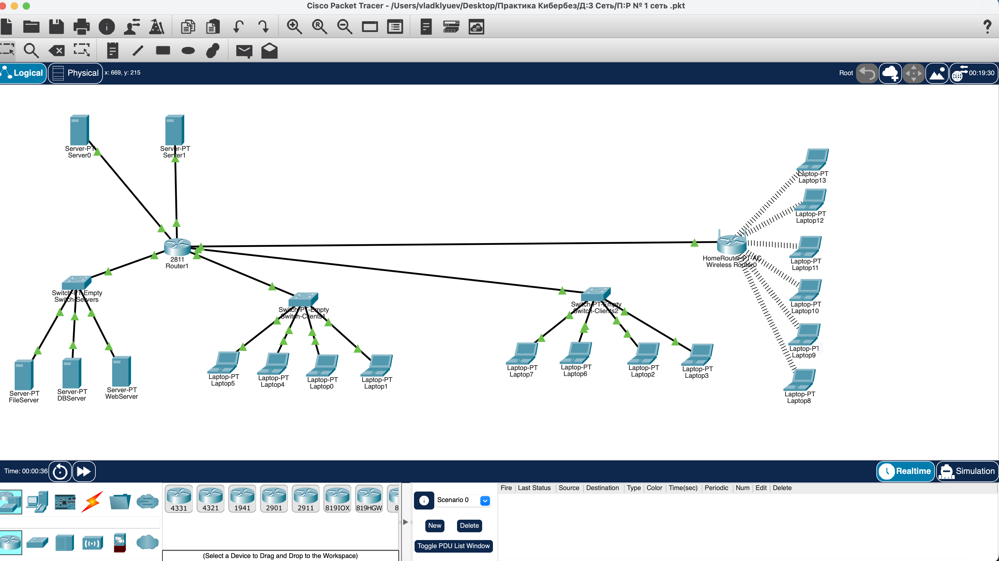

# Практическая работа: Создание сети в Cisco Packet Tracer

## 🎯 Цель работы
Научиться создавать сеть с использованием маршрутизаторов, коммутаторов и Wi-Fi-роутера, назначать IPv4-адреса, настраивать DHCP-сервер и Wi-Fi-роутер, проверять связность между узлами.

## 📋 Задание
1. Построить схему сети: маршрутизатор 2811, три коммутатора PT-Empty, серверная стойка, ноутбуки, Wi-Fi-роутер, два внешних сервера.
2. Настроить сетевые интерфейсы, статические адреса серверов, DHCP для ноутбуков, Wi-Fi.
3. Проверить связность через ping.

## 🛠️ Использованные технологии и оборудование
- Cisco Packet Tracer
- Маршрутизатор Cisco 2811 (модули Gigabit Ethernet + оптические интерфейсы)
- Коммутаторы PT-Empty (оптические + Gigabit Ethernet интерфейсы)
- Wi-Fi-роутер (Wireless Router-PT)
- Серверы (статическая адресация)
- Ноутбуки (DHCP)
- Типы подключений: медное, оптоволоконное, Wi-Fi
- DHCP, статическая маршрутизация
- Аннотации через Place Note для подписи IP-адресов

## 🌐 Схема сети

### Топология
- Маршрутизатор 2811 (Router1) — центральный узел
- Switch-Servers — серверная стойка: FileServer, DBServer, WebServer
- Switch-Client1 — проводные ноутбуки (Laptop0, 1, 4, 5)
- Switch-Client2 — проводные ноутбуки (Laptop2, 3, 6, 7)
- HomeRouter (Wireless Router0) — Wi-Fi-сегмент с 6 ноутбуками (Laptop8–13)
- Server0 и Server1 — внешние серверы (имитация интернета), подключены к маршрутизатору

### Адресация (пример)
| Устройство | IP-адрес | Маска | Назначение |
|------------|----------|-------|------------|
| Router1 Gig2/0/0 | 192.168.10.1 | /24 | Серверная сеть |
| Router1 Gig2/0/1 | 192.168.20.1 | /24 | Сеть клиентов 1 |
| Router1 Gig2/0/2 | 192.168.30.1 | /24 | Сеть клиентов 2 |
| Router1 Gig1/0 | 8.8.1.1 | /24 | Внешняя сеть |
| Server1 | 8.8.8.224 | /24 | Внешний сервер |
| FileServer / DBServer / WebServer | 192.168.10.x | /24 | Статические |
| Laptop0–7 | DHCP от Router1 | /24 | Динамические |
| Laptop8–13 | DHCP от HomeRouter | /24 | Wi-Fi |

## 📸 Скриншот топологии

На схеме видно:
- Центральный маршрутизатор 2811 с подключёнными коммутаторами и Wi-Fi-роутером
- Три коммутатора с серверами и ноутбуками
- Все три типа соединений: медное, оптоволоконное, Wi-Fi
- Зелёные индикаторы (все соединения активны)
- Подписи IP-адресов через Place Note

## 📦 Файл проекта

Файл [network.pkt](network.pkt) — это проект Cisco Packet Tracer. Он содержит полную топологию со всеми настройками:
- IP-адреса на интерфейсах маршрутизатора
- Статические адреса серверов
- Настройки DHCP на маршрутизаторе
- Настройки Wi-Fi-роутера
- Все соединения и аннотации

Чтобы открыть: скачать файл и запустить в Cisco Packet Tracer (бесплатная программа, требует регистрации на Cisco NetAcad).

## 🎯 На что обратить внимание в проекте

Если будете открывать .pkt:
1. Router1 → вкладка CLI → show ip route — таблица маршрутизации.
2. Router1 → вкладка CLI → show ip interface brief — все интерфейсы с IP.
3. Router1 → CLI → show running-config — полная конфигурация с DHCP-пулами.
4. FileServer / DBServer / WebServer → вкладка Desktop → IP Configuration — статические адреса.
5. Laptop0–13 → Desktop → IP Configuration — адреса получены по DHCP.
6. HomeRouter → GUI → Wireless — настройки SSID и безопасности.
7. Топология → проверить три типа соединений: медные, оптические, беспроводные.

## 📊 Что сделано
- Подготовлен маршрутизатор 2811 с модулями Gigabit Ethernet и оптическими интерфейсами.
- Подготовлены и клонированы коммутаторы PT-Empty.
- К одному коммутатору подключены три сервера (серверная стойка).
- К остальным коммутаторам подключены проводные ноутбуки.
- Добавлен Wi-Fi-роутер и подключён к маршрутизатору.
- Настроены ноутбуки с Wi-Fi-адаптером и подключены к беспроводной сети.
- Добавлены два внешних сервера (Server0, Server1 с IP 8.8.8.224), подключены по оптоволокну.
- Настроена адресация: статическая для серверов, DHCP для ноутбуков.
- Настроены DHCP-диапазоны на маршрутизаторе и Wi-Fi-роутере.
- Выполнены аннотации IP-адресов через Place Note.
- Проверена связность через ping между всеми сегментами сети.

## 🧠 Чему научился
- Построение топологии сети в Cisco Packet Tracer.
- Добавление и настройка модулей маршрутизатора и коммутатора.
- Работа с разными типами подключений: медное, оптоволоконное, Wi-Fi.
- Настройка статической адресации серверов.
- Настройка DHCP на маршрутизаторе для ноутбуков.
- Настройка Wi-Fi-роутера и беспроводных клиентов.
- Использование аннотаций (Place Note) для документирования схемы.
- Проверка связности через ping и traceroute.

## 🔐 Практическая значимость
Навыки работы с Cisco Packet Tracer — базовые для сетевого инженера и специалиста по ИБ:
- понимание топологии сети и адресации;
- настройка DHCP и маршрутизации;
- работа с беспроводными сегментами;
- проверка связности и диагностика.

Эти навыки применяются при проектировании корпоративных сетей, анализе защищённости инфраструктуры и расследовании сетевых инцидентов.
