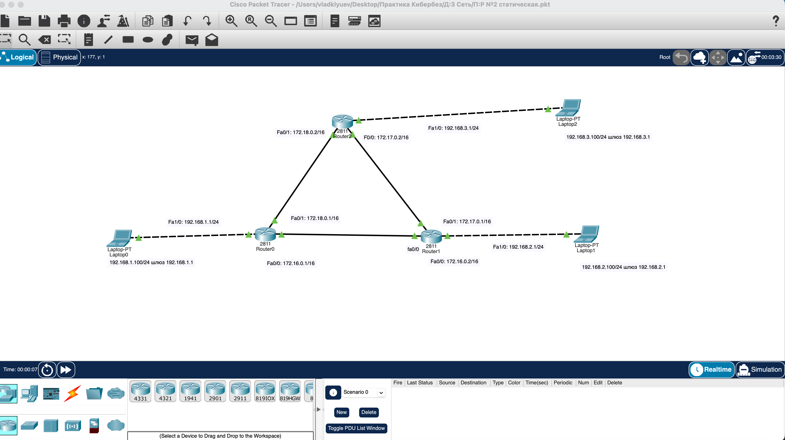
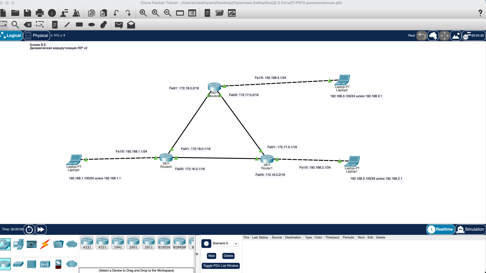

# Практическая работа: Статическая и динамическая маршрутизация

## 🎯 Цель работы
Создать сеть по заданным параметрам и применить настройки маршрутизации к внешним и внутренним частям сети. Освоить статическую и динамическую маршрутизацию (RIP v2).

## 📋 Задание
1. Построить топологию сети из трёх маршрутизаторов Cisco 2811 и трёх ноутбуков.
2. Настроить статическую маршрутизацию с односторонним движением пакетов между роутерами.
3. Заменить статическую маршрутизацию динамической (RIP v2).
4. Проверить связность через tracert и sh ip route.

## 🛠️ Использованные технологии
- Cisco Packet Tracer
- Маршрутизаторы Cisco 2811 (Router0, Router1, Router2)
- Статическая маршрутизация
- Динамическая маршрутизация RIPv2
- Классовая адресация (/16) и бесклассовая (/24)
- Команды диагностики: tracert, show ip route

## 🌐 Схема сети

### Топология
- Router0 — левый маршрутизатор
- Router1 — правый маршрутизатор
- Router2 — верхний маршрутизатор
- Laptop0, Laptop1, Laptop2 — по одному ноутбуку на каждый роутер

### Адресация интерфейсов

| Устройство | Интерфейс | IP-адрес | Маска |
|------------|-----------|----------|-------|
| Router0 | Fa1/0 (к Laptop0) | 192.168.1.1 | /24 |
| Router0 | Fa0/0 (к Router1) | 172.16.0.1 | /16 |
| Router0 | Fa0/1 (к Router2) | 172.18.0.1 | /16 |
| Router1 | Fa1/0 (к Laptop1) | 192.168.2.1 | /24 |
| Router1 | Fa0/0 (к Router0) | 172.16.0.2 | /16 |
| Router1 | Fa0/1 (к Router2) | 172.17.0.1 | /16 |
| Router2 | Fa1/0 (к Laptop2) | 192.168.3.1 | /24 |
| Router2 | Fa0/0 (к Router1) | 172.17.0.2 | /16 |
| Router2 | Fa0/1 (к Router0) | 172.18.0.2 | /16 |

### Шлюзы ноутбуков
- Laptop0: 192.168.1.100/24, шлюз 192.168.1.1
- Laptop1: 192.168.2.100/24, шлюз 192.168.2.1
- Laptop2: 192.168.3.100/24, шлюз 192.168.3.1

---

## 📸 Задание 1. Статическая маршрутизация

### Топология

Схема собрана из трёх маршрутизаторов Cisco 2811, соединённых треугольником. Каждый маршрутизатор подключён к своему ноутбуку. Все IP-адреса подписаны через Place Note. Указано Ф.И.О. и назначение схемы: «статическая маршрутизация».

### Настройка статической маршрутизации

Настроено одностороннее движение пакетов между роутерами:
- от Router0 → Router2
- от Router2 → Router1
- от Router1 → Router0

Это реализовано через команды ip route с указанием только одного следующего хопа. Такая схема полезна для демонстрации управления трафиком и для отработки понимания принципов маршрутизации.

Пример команд на Router0:
ip route 192.168.3.0 255.255.255.0 172.18.0.2

Это маршрут к сети Laptop2 через Router2.

На Router1:
ip route 192.168.1.0 255.255.255.0 172.16.0.1

На Router2:
ip route 192.168.2.0 255.255.255.0 172.17.0.1

### Проверка связности

С каждого ноутбука выполнены трассировки:
- Laptop0 → tracert 192.168.2.100 (до Laptop1)
- Laptop2 → tracert 192.168.1.100 (до Laptop0)
- Laptop1 → tracert 192.168.3.100 (до Laptop2)

На каждом роутере выполнена команда show ip route для подтверждения таблицы маршрутизации.

Из-за односторонней маршрутизации связность работает не для всех направлений. Это соответствует заданию.

---

## 📸 Задание 2. Динамическая маршрутизация (RIP v2)

### Топология

Та же схема, но маршрутизация настроена динамически через RIP v2. Указано Ф.И.О. и назначение: «Динамическая маршрутизация RIPv2».

### Настройка RIPv2

На каждом маршрутизаторе:
router rip
 version 2
 no auto-summary
 network 172.16.0.0
 network 172.17.0.0
 network 172.18.0.0
 network 192.168.1.0   (для Router0)
 network 192.168.2.0   (для Router1)
 network 192.168.3.0   (для Router2)

Параметр no auto-summary отключает автоматическое суммирование маршрутов по классовым границам — это важно при использовании /16 и /24 сетей в одной топологии.

### Проверка

С каждого ноутбука проверена связность через tracert в оба направления. В отличие от статической маршрутизации, RIPv2 обеспечивает двустороннюю связность между всеми сетями.

---

## 📦 Файлы проектов

### [static-routing.pkt](static-routing.pkt)
Проект Packet Tracer со статической маршрутизацией. Открывается в Cisco Packet Tracer.
- Что смотреть: Router0 / Router1 / Router2 → CLI → show ip route
- Ожидаемый результат: в таблице маршрутизации видны только маршруты, настроенные вручную (S — static).

### [dynamic-routing-rip.pkt](dynamic-routing-rip.pkt)
Проект Packet Tracer с динамической маршрутизацией RIPv2. Открывается в Cisco Packet Tracer.
- Что смотреть: Router0 / Router1 / Router2 → CLI → show ip route
- Ожидаемый результат: маршруты помечены R (RIP), связи двусторонние.
- Дополнительно: Router0 → CLI → show ip protocols — параметры RIP.

---

## 🎯 На что обратить внимание

Если открываете .pkt:

1. Router0 → CLI → show ip route — таблица маршрутизации. Сравните статическую и динамическую версии.
2. Router1 → CLI → show ip route — то же для второго роутера.
3. Router2 → CLI → show ip route — то же для третьего.
4. Router0 → CLI → show ip protocols — в динамической версии покажет настройки RIP.
5. Laptop0 → Desktop → Command Prompt → tracert 192.168.2.100 — трассировка до Laptop1.
6. Laptop2 → Command Prompt → tracert 192.168.1.100 — трассировка до Laptop0.

### Ключевая разница

| Параметр | Статическая | Динамическая (RIPv2) |
|----------|-------------|----------------------|
| Настройка | Вручную на каждом роутере | Через router rip |
| Связность | Односторонняя (по заданию) | Двусторонняя |
| Таблица маршрутизации | Помечена S | Помечена R |
| Масштабируемость | Плохая | Хорошая |

---

## 📊 Выводы
- Освоена настройка статической маршрутизации через команды ip route.
- Изучена разница между односторонней и двусторонней маршрутизацией.
- Отработана настройка динамической маршрутизации через RIPv2.
- Изучены команды диагностики: tracert, show ip route, show ip protocols.
- Понято, зачем нужен параметр no auto-summary при работе с /16 и /24 сетями.
- Отработана топология с тремя маршрутизаторами, соединёнными треугольником.

## 🧠 Чему научился
- Построение сети с тремя маршрутизаторами Cisco 2811.
- Настройка IP-адресов на интерфейсах маршрутизаторов.
- Настройка статических маршрутов (ip route).
- Настройка динамической маршрутизации RIPv2 (router rip, version 2, network).
- Проверка маршрутизации через show ip route и show ip protocols.
- Диагностика связности через tracert и ping.
- Понимание принципов маршрутизации в сетях с несколькими подсетями.

## 🔐 Практическая значимость
Понимание маршрутизации — ключевой навык сетевого инженера и специалиста по ИБ:
- анализ путей прохождения трафика;
- выявление аномалий маршрутизации (петли, асимметрия);
- настройка сегментации сети;
- понимание того, как злоумышленник может использовать неправильную маршрутизацию для перехвата трафика (MITM).
