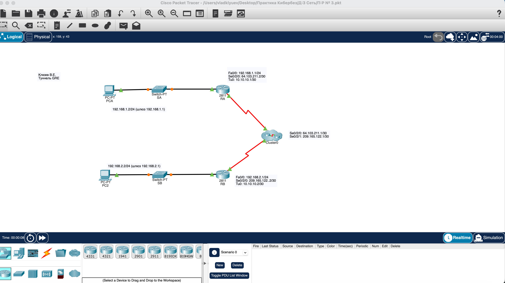

# Практическая работа: Настройка туннеля GRE

## 🎯 Цель работы
Создать собственный виртуальный туннель GRE между двумя маршрутизаторами для связи удалённых офисов через публичную сеть.

## 📋 Задание
1. Проверить подключение между маршрутизаторами RA и RB.
2. Настроить туннель GRE на обоих маршрутизаторах.
3. Настроить статические маршруты для частного трафика через туннель.
4. Проверить связность между PC-A и PC-C через туннель.

## 🛠️ Использованные технологии
- Cisco Packet Tracer
- Маршрутизаторы Cisco 2811 (RA, RB)
- Коммутаторы Switch-PT (SA, SB)
- Туннель GRE (Generic Routing Encapsulation)
- Статическая маршрутизация
- Кластер (Cluster0) — имитация публичной сети

## 🌐 Схема сети

### Топология
- **RA** — маршрутизатор офиса A
- **RB** — маршрутизатор офиса B
- **Cluster0** — облако публичной сети между ними
- **PC-A** — компьютер в сети офиса A (192.168.1.2)
- **PC-C** — компьютер в сети офиса B (192.168.2.2)

### Таблица адресации

| Устройство | Интерфейс | IP-адрес | Маска | Шлюз |
|------------|-----------|----------|-------|------|
| RA | G0/0 | 192.168.1.1 | 255.255.255.0 | — |
| RA | S0/0/0 | 64.103.211.2 | 255.255.255.252 | — |
| RA | Tunnel 0 | 10.10.10.1 | 255.255.255.252 | — |
| RB | G0/0 | 192.168.2.1 | 255.255.255.0 | — |
| RB | S0/0/0 | 209.165.122.2 | 255.255.255.252 | — |
| RB | Tunnel 0 | 10.10.10.2 | 255.255.255.252 | — |
| PC-A | NIC | 192.168.1.2 | 255.255.255.0 | 192.168.1.1 |
| PC-C | NIC | 192.168.2.2 | 255.255.255.0 | 192.168.2.1 |

## 📸 Скриншот топологии

На схеме видно:
- Два маршрутизатора RA и RB, соединённые через облако Cluster0
- Коммутаторы SA и SB с компьютерами PC-A и PC-C
- Все IP-адреса подписаны через Place Note
- Указано Ф.И.О. и назначение схемы: «Туннель GRE»
- Зелёные индикаторы — все соединения активны

## 📦 Файл проекта

Файл [gre-tunnel.pkt](gre-tunnel.pkt) — проект Cisco Packet Tracer с полной настройкой туннеля GRE. Содержит:
- Настройку интерфейсов RA и RB (физических и туннельных)
- Настройку туннеля GRE (source, destination, mode)
- Статические маршруты между частными сетями через туннель
- Рабочую связность между PC-A и PC-C

Чтобы открыть: скачать файл и запустить в Cisco Packet Tracer.

## 🎯 На что обратить внимание в проекте

Если будете открывать .pkt:

1. **RA → CLI → `show ip interface brief`** — все интерфейсы, включая Tunnel0.
2. **RA → CLI → `show interface tunnel 0`** — параметры туннеля (source, destination, mode GRE).
3. **RA → CLI → `show ip route`** — таблица маршрутизации. Должен быть маршрут к 192.168.2.0/24 через 10.10.10.2.
4. **RB → CLI → `show interface tunnel 0`** — параметры туннеля RB.
5. **RB → CLI → `show ip route`** — маршрут к 192.168.1.0/24 через 10.10.10.1.
6. **PC-C → Desktop → Command Prompt → `ping 192.168.1.2`** — проверка связности через туннель.

## 📊 Что сделано

- Проверено подключение между RA и RB через публичную сеть.
- Определён IP-адрес интерфейса S0/0/0 маршрутизатора RA через `show ip interface brief`.
- Выполнен ping с RB на S0/0/0 RA.
- Настроен интерфейс Tunnel0 на RA:
  - IP-адрес: 10.10.10.1/30
  - Source: S0/0/0
  - Destination: 209.165.122.2
  - Mode: GRE IP
  - Интерфейс поднят (`no shutdown`)
- Настроен интерфейс Tunnel0 на RB (аналогично, с IP 10.10.10.2).
- Настроены статические маршруты:
  - RA: `ip route 192.168.2.0 255.255.255.0 10.10.10.2`
  - RB: `ip route 192.168.1.0 255.255.255.0 10.10.10.1`
- Проверена связность между PC-A и PC-C через туннель GRE.

## 🧠 Чему научился
- Настройка туннеля GRE на маршрутизаторах Cisco.
- Использование команд `interface tunnel`, `tunnel source`, `tunnel destination`, `tunnel mode gre ip`.
- Понимание разницы между физическим и туннельным интерфейсом.
- Настройка статической маршрутизации через туннель.
- Диагностика туннеля через `show interface tunnel`.
- Проверка связности через ping между удалёнными сетями.
- Понимание, зачем нужны туннели: объединение удалённых офисов, обход ограничений публичной сети.

## 🔐 Практическая значимость
Туннели GRE — важный инструмент для сетевого инженера и специалиста по ИБ:
- объединение территориально распределённых сетей через публичный интернет;
- создание VPN-подобных решений на уровне L3;
- обеспечение связности между офисами без прямого физического соединения;
- база для построения защищённых каналов (GRE over IPsec).

Понимание GRE позволяет проектировать распределённые корпоративные сети и анализировать трафик между удалёнными сегментами.
