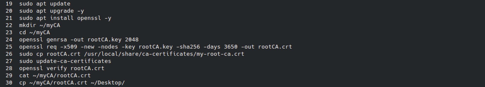
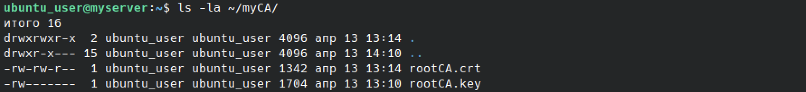
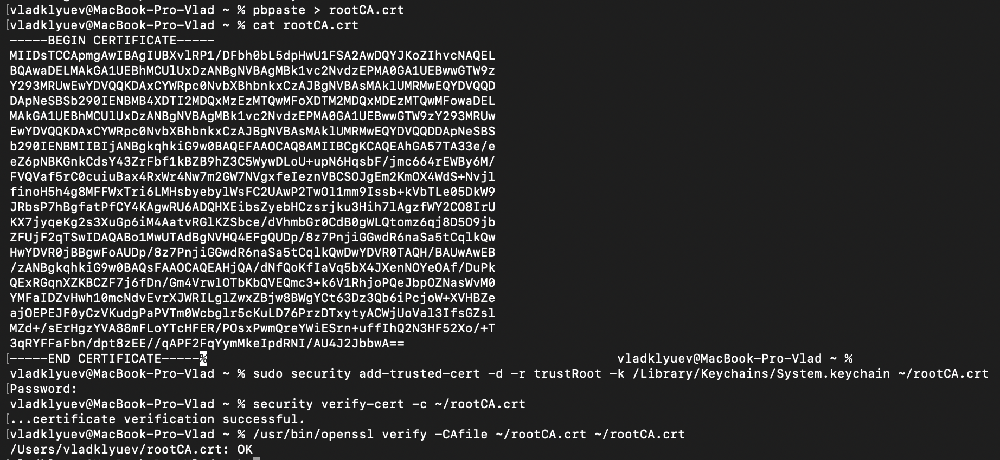

# Практическая работа: Создание собственного центра сертификации

## 🎯 Цель работы
Создать собственный корневой центр сертификации (CA) на виртуальной машине Ubuntu, внести сертификат в другую систему и проверить его валидность.

## 📋 Задание
1. Установить виртуальную машину с Ubuntu (не позднее 20-й версии).
2. Создать собственный сертификат (CA) любым удобным способом.
3. Внести сертификат в другую систему и проверить его валидность командой openssl verify.

## 🛠️ Использованные инструменты
- VirtualBox (виртуальная машина с Ubuntu)
- OpenSSL — генерация ключей и сертификатов
- update-ca-certificates — добавление в доверенные хранилища Linux
- security (macOS) — добавление сертификата в доверенные на macOS
- macOS — вторая система для проверки

## 🌐 Схема работы

1. Ubuntu VM — создание корневого сертификата CA (rootCA.crt + rootCA.key).
2. Перенос сертификата на macOS (через pbpaste или копирование файла).
3. macOS — добавление сертификата в доверенные, проверка валидности.

---

## 📸 Задание 1. Создание центра сертификации на Ubuntu

### 1. Команды создания CA

На виртуальной машине Ubuntu выполнены команды:

sudo apt update
sudo apt upgrade -y
sudo apt install openssl -y
mkdir ~/myCA
cd ~/myCA
openssl genrsa -out rootCA.key 2048
openssl req -x509 -new -nodes -key rootCA.key -sha256 -days 3650 -out rootCA.crt
sudo cp rootCA.crt /usr/local/share/ca-certificates/my-root-ca.crt
sudo update-ca-certificates
openssl verify rootCA.crt
cat ~/myCA/rootCA.crt
cp ~/myCA/rootCA.crt ~/Desktop/

Разбор команд:

| Команда | Назначение |
|---------|-----------|
| sudo apt install openssl | Установка OpenSSL |
| mkdir ~/myCA | Создание рабочего каталога для CA |
| openssl genrsa -out rootCA.key 2048 | Генерация приватного ключа RSA 2048 бит |
| openssl req -x509 -new -nodes ... | Создание самоподписанного корневого сертификата на 3650 дней (10 лет) |
| cp rootCA.crt /usr/local/share/ca-certificates/ | Копирование сертификата в системное хранилище |
| update-ca-certificates | Обновление списка доверенных сертификатов в Ubuntu |
| openssl verify rootCA.crt | Проверка валидности сертификата |
| cp ~/myCA/rootCA.crt ~/Desktop/ | Копирование сертификата на рабочий стол для переноса |

Ключевые параметры openssl req:
- -x509 — создание самоподписанного сертификата формата X.509
- -new — новый запрос на сертификат
- -nodes — без шифрования приватного ключа (без пароля)
- -key rootCA.key — использовать существующий приватный ключ
- -sha256 — алгоритм подписи SHA-256
- -days 3650 — срок действия 10 лет
- -out rootCA.crt — имя выходного файла

### 2. Проверка созданных файлов

ls -la ~/myCA/

Результат:
- rootCA.crt — 1342 байта, права -rw-rw-r--, создан 13 апр 13:14
- rootCA.key — 1704 байта, права -rw-------, создан 13 апр 13:10

Приватный ключ (rootCA.key) имеет права 600 — только владелец может читать/писать. Это важно для безопасности: если ключ попадёт в чужие руки, можно подделывать сертификаты от имени CA.

Публичный сертификат (rootCA.crt) имеет права 664 — читать могут все, это нормально.

---

## 📸 Задание 2. Внесение сертификата в macOS и проверка

### 3. Добавление сертификата в доверенные и проверка

Сертификат перенесён на macOS через pbpaste (содержимое буфера обмена) и сохранён в ~/rootCA.crt.

Просмотр сертификата:
cat rootCA.crt

Вывод: содержимое сертификата в формате PEM (BEGIN CERTIFICATE / END CERTIFICATE).

Добавление в доверенные системного хранилища macOS:
sudo security add-trusted-cert -d -r trustRoot -k /Library/Keychains/System.keychain ~/rootCA.crt

Параметры:
- -d — добавить в системное хранилище (system keychain)
- -r trustRoot — установить доверие как корневому CA
- -k /Library/Keychains/System.keychain — указать системное хранилище
- ~/rootCA.crt — путь к файлу сертификата

Проверка через security verify-cert:
security verify-cert -c ~/rootCA.crt

Результат: ...certificate verification successful.

Проверка через openssl verify:
/usr/bin/openssl verify -CAfile ~/rootCA.crt ~/rootCA.crt

Результат: /Users/vladklyuev/rootCA.crt: OK

Это значит: сертификат валиден, подпись корректна, сертификат успешно добавлен в доверенные системы macOS.

---

## 📊 Выводы
- Освоено создание корневого центра сертификации через OpenSSL.
- Изучена генерация приватного ключа RSA и самоподписанного сертификата X.509.
- Отработано добавление сертификата в доверенные хранилища Linux (update-ca-certificates) и macOS (security add-trusted-cert).
- Изучены команды проверки валидности: openssl verify и security verify-cert.
- Понят принцип доверия: чтобы система не считала сертификат самоподписанным, его нужно добавить в её доверенное хранилище.
- Отработан перенос сертификата между системами (Ubuntu → macOS).

## 🧠 Чему научился
- Установка OpenSSL и работа с командами генерации сертификатов.
- Создание приватного ключа (openssl genrsa).
- Создание самоподписанного сертификата (openssl req -x509).
- Различия между .key (приватный) и .crt (публичный).
- Добавление сертификата в доверенные хранилища Linux и macOS.
- Проверка валидности через openssl verify и security verify-cert.
- Понимание разницы между Self-Signed Certificate и доверенным сертификатом.
- Понимание принципа Chain of Trust: корневой CA → промежуточный → конечный.

## 🔐 Практическая значимость
Навыки работы с сертификатами — критичны для специалиста по ИБ:
- создание внутреннего CA для корпоративной инфраструктуры;
- выпуск сертификатов для внутренних сервисов (веб, VPN, почта);
- проверка подлинности сертификатов внешних ресурсов;
- анализ цепочек доверия;
- выявление поддельных или просроченных сертификатов;
- настройка HTTPS внутри компании без покупки внешних сертификатов.

Собственный CA — базовый инструмент для защиты внутренних сервисов, шифрования трафика и обеспечения доверия между системами внутри организации.

## ⚠️ Особенности выполнения
- Права доступа: приватный ключ rootCA.key имеет права 600 (только владелец). Это критично: компрометация ключа CA = компрометация всех выпущенных сертификатов.
- Срок действия: сертификат создан на 3650 дней (10 лет) — типичный срок для корневого CA.
- Перенос между системами: сертификат перенесён с Ubuntu на macOS через буфер обмена (pbpaste). В реальной среде используется защищённый канал (SCP, защищённая почта, USB).
- Доверие в macOS: для системного хранилища требуется sudo.
