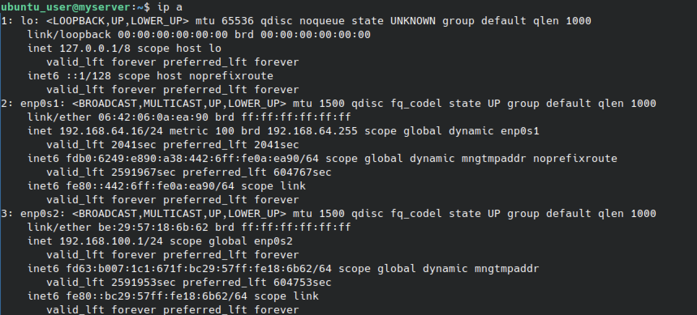
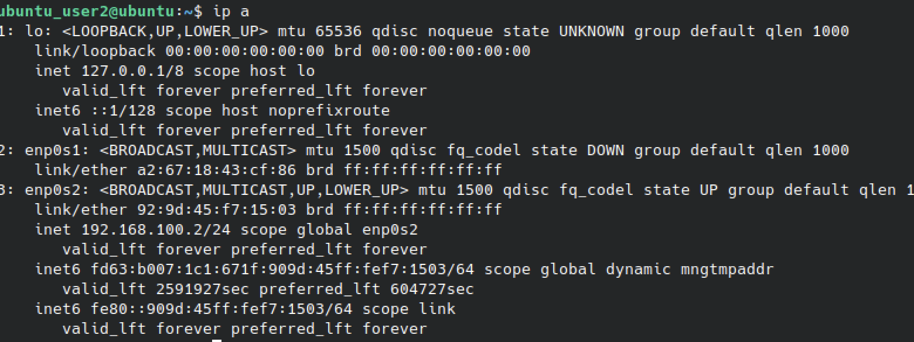
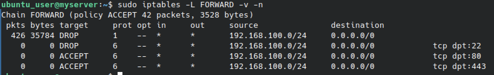
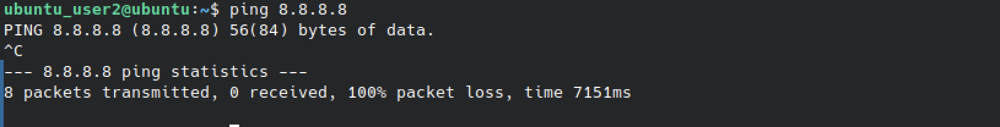
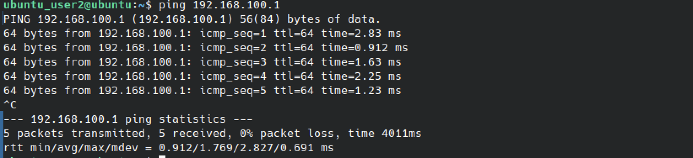
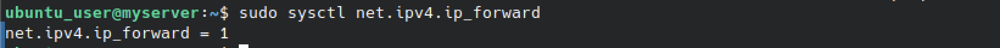

# Практическая работа: Виртуальный межсетевой экран

## 🎯 Цель работы
Создать виртуальный межсетевой экран на базе двух виртуальных машин Ubuntu, настроить пересылку трафика между ними и правила фильтрации iptables.

## 📋 Задание
1. Установить две виртуальные машины Ubuntu в VirtualBox.
2. Соединить машины между собой и с интернетом.
3. Настроить пересылку трафика (IP forwarding) с vm2 в интернет через vm1.
4. Настроить три правила в iptables.

## 🛠️ Использованные инструменты
- VirtualBox
- Ubuntu (две виртуальные машины: myserver и ubuntu)
- iptables — межсетевой экран
- sysctl — управление параметрами ядра
- ip a, ping — диагностика сети

## 🌐 Схема сети

| Машина | Интерфейс | IP-адрес | Маска | Назначение |
|--------|-----------|----------|-------|------------|
| vm1 (myserver) | enp0s1 | 192.168.64.16 | /24 | Внешний (NAT/мост) — доступ в интернет |
| vm1 (myserver) | enp0s2 | 192.168.100.1 | /24 | Внутренняя сеть между vm1 и vm2 |
| vm2 (ubuntu) | enp0s2 | 192.168.100.2 | /24 | Внутренняя сеть |

vm1 (myserver) выполняет роль межсетевого экрана: имеет два интерфейса — внешний (192.168.64.16, через NAT) и внутренний (192.168.100.1, для связи с vm2).

vm2 (ubuntu) имеет только один интерфейс — 192.168.100.2, и весь трафик в интернет идёт через vm1.

---

## 📸 Задание 1. Настройка сети

### 1. Настройка сетевых интерфейсов на vm1

ip a

Результат на myserver:
- lo — loopback (127.0.0.1/8)
- enp0s1 — внешний интерфейс: 192.168.64.16/24 (динамический, через NAT)
- enp0s2 — внутренний интерфейс: 192.168.100.1/24 (статический)

Это значит: vm1 имеет два интерфейса — один смотрит в интернет, второй — во внутреннюю сеть.

### 2. Настройка сетевых интерфейсов на vm2

ip a

Результат на ubuntu:
- lo — loopback
- enp0s1 — выключен (state DOWN), без IP
- enp0s2 — активный интерфейс: 192.168.100.2/24 (статический)

Это значит: vm2 имеет только один рабочий интерфейс — во внутренней сети. Интернет для неё доступен только через vm1.

### 3. Проверка связности vm2 → vm1

ping 192.168.100.1

Результат: 5 packets transmitted, 5 received, 0% packet loss.

Время отклика — 0.9–2.8 мс. Связь между vm1 и vm2 работает.

### 4. Проверка доступа в интернет с vm2 (до настройки)

ping 8.8.8.8

Результат: 8 packets transmitted, 0 received, 100% packet loss.

До настройки IP forwarding и правил iptables vm2 не может выйти в интернет. Это ожидаемо: у неё нет маршрута наружу.

---

## 📸 Задание 2. Настройка пересылки трафика

### 5. Включение IP forwarding на vm1

sudo sysctl net.ipv4.ip_forward

Результат: net.ipv4.ip_forward = 1

IP forwarding включён. Это значит: vm1 будет пересылать пакеты между своими интерфейсами (enp0s1 и enp0s2). Без этого параметра ядро Linux не пропускает трафик транзитом.

Чтобы значение сохранилось после перезагрузки, его прописывают в /etc/sysctl.conf:
net.ipv4.ip_forward = 1

### 6. Правила iptables на vm1

sudo iptables -L FORWARD -v -n

Результат в цепочке FORWARD:

| Пакеты | Байты | Target | Prot | Source | Destination | Дополнительно |
|--------|-------|--------|------|--------|-------------|---------------|
| 426 | 35784 | DROP | all | 192.168.100.0/24 | 0.0.0.0/0 | — |
| 0 | 0 | DROP | tcp | 192.168.100.0/24 | 0.0.0.0/0 | tcp dpt:22 |
| 0 | 0 | ACCEPT | tcp | 192.168.100.0/24 | 0.0.0.0/0 | tcp dpt:80 |
| 0 | 0 | ACCEPT | tcp | 192.168.100.0/24 | 0.0.0.0/0 | tcp dpt:443 |

Разбор правил:

1. DROP всё из сети 192.168.100.0/24 — базовое правило «запрещено всё».
2. DROP SSH (22) — запрет SSH из внутренней сети (безопасность).
3. ACCEPT HTTP (80) — разрешён веб-трафик по HTTP.
4. ACCEPT HTTPS (443) — разрешён веб-трафик по HTTPS.

Это классическая схема: запрещено всё, кроме явно разрешённого. Разрешён только веб-трафик — так настраивают шлюзы в офисах, где сотрудникам нужен интернет, но не нужен SSH наружу.

Политика цепочки FORWARD — ACCEPT, но правила выше перекрывают её: если пакет попадает под DROP, он отбрасывается.

Счётчик 426 пакетов в правиле DROP означает, что 426 пакетов уже были отброшены — то есть правило активно работает.

---

## 🎯 Как воспроизвести

### Настройка vm1 (myserver)

1. Добавить второй сетевой адаптер в VirtualBox (внутренняя сеть или Host-only).
2. Назначить IP-адрес на внутренний интерфейс:
sudo ip addr add 192.168.100.1/24 dev enp0s2
sudo ip link set enp0s2 up

3. Включить IP forwarding:
sudo sysctl -w net.ipv4.ip_forward=1

4. Настроить NAT (маскарадинг) для выхода в интернет:
sudo iptables -t nat -A POSTROUTING -o enp0s1 -j MASQUERADE

5. Настроить правила фильтрации:
sudo iptables -A FORWARD -s 192.168.100.0/24 -j DROP
sudo iptables -A FORWARD -s 192.168.100.0/24 -p tcp --dport 22 -j DROP
sudo iptables -A FORWARD -s 192.168.100.0/24 -p tcp --dport 80 -j ACCEPT
sudo iptables -A FORWARD -s 192.168.100.0/24 -p tcp --dport 443 -j ACCEPT

### Настройка vm2 (ubuntu)

1. Назначить IP-адрес:
sudo ip addr add 192.168.100.2/24 dev enp0s2
sudo ip link set enp0s2 up

2. Настроить шлюз по умолчанию:
sudo ip route add default via 192.168.100.1

3. Проверить связность:
ping 192.168.100.1
ping 8.8.8.8

---

## 📊 Выводы
- Освоено создание виртуального межсетевого экрана на базе Ubuntu.
- Настроены два сетевых интерфейса на vm1: внешний (NAT) и внутренний.
- Включён IP forwarding — без него трафик не проходит между интерфейсами.
- Настроены правила iptables в цепочке FORWARD для фильтрации трафика из внутренней сети.
- Реализована схема «запрещено всё, кроме явно разрешённого» (whitelist).
- Проверена связность: vm2 → vm1 работает, vm2 → интернет — только через настроенный шлюз.

## 🧠 Чему научился
- Настройка сетевых интерфейсов через ip addr и ip link.
- Включение IP forwarding через sysctl.
- Работа с цепочкой FORWARD в iptables.
- Настройка правил фильтрации по IP-адресу источника и порту назначения.
- Понимание разницы между INPUT, OUTPUT и FORWARD.
- Понимание принципа работы межсетевого экрана как маршрутизатора с фильтрацией.
- Диагностика сети через ip a и ping.

## 🔐 Практическая значимость
Настройка межсетевого экрана — базовая задача администратора и специалиста по ИБ:
- контроль трафика между сегментами сети;
- разграничение доступа во внутренней сети;
- блокировка нежелательного трафика (SSH, сканирование портов);
- разрешение только необходимых сервисов (HTTP/HTTPS);
- построение DMZ и сегментация инфраструктуры.

Понимание iptables и IP forwarding — фундамент для настройки корпоративных шлюзов, VPN-серверов и защиты периметра.

## ⚠️ Особенности выполнения
- Правило DROP стоит первым. В iptables правила обрабатываются сверху вниз, и первое совпадение останавливает обработку. Поэтому сначала идёт DROP для всей сети, а потом разрешения для конкретных портов. Если поменять местами — разрешения работать не будут.
- NAT (MASQUERADE) не настроен в скриншотах. Без NAT трафик из vm2 не сможет выйти в интернет даже при включённом IP forwarding, потому что у vm2 частный адрес 192.168.100.2. Чтобы интернет заработал, нужно добавить правило MASQUERADE в цепочку POSTROUTING.
- Сохранение правил: по умолчанию iptables сбрасывает правила при перезагрузке. Для сохранения используется iptables-save и iptables-restore.
