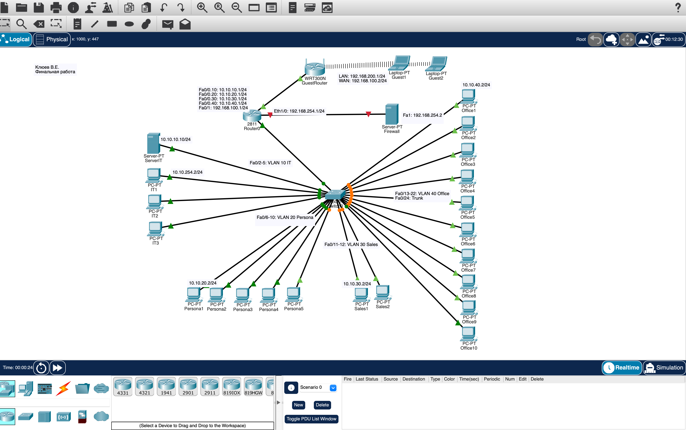

# Финальная работа: Логическая сеть с центром сертификации и фаерволом

## 🎯 Цель работы
Создать проект логической сети предприятия с использованием центра сертификации и межсетевого экрана.

## 📋 Задание
1. Настроить сеть в Cisco Packet Tracer: 20 ПК, 4 отдела, VLAN, FTP-сервер, фаервол, гостевая Wi-Fi-сеть.
2. Создать центр сертификации в Ubuntu с четырьмя сертификатами для отделов.
3. Настроить три правила iptables для фильтрации трафика.

## 🛠️ Использованные инструменты
- Cisco Packet Tracer
- VirtualBox / UTM (виртуальная машина Ubuntu)
- OpenSSL — центр сертификации
- iptables — межсетевой экран
- VLAN, маршрутизация, FTP, Wi-Fi

## 🌐 Структура сети

### Отделы и VLAN

| Отдел | VLAN | Количество ПК | Подсеть |
|-------|------|---------------|---------|
| Отдел IT | VLAN 10 (IT) | 3 ПК + сервер | 10.10.10.0/24 |
| Отдел кадров | VLAN 20 (Persona) | 5 ПК | 10.10.20.0/24 |
| Отдел продаж | VLAN 30 (Sales) | 2 ПК | 10.10.30.0/24 |
| Офис | VLAN 40 (SkillBox) | 10 ПК | 10.10.40.0/24 |

Всего: 20 ПК + сервер IT + сервер-фаервол + гостевая сеть.

### Оборудование

- Router0 (Cisco 2811) — маршрутизатор с sub-интерфейсами для каждого VLAN
- Switch0 — центральный коммутатор с trunk-портом (Fa0/24)
- ServerIT — сервер в VLAN 10 (FTP + центр сертификации), IP 10.10.10.10/24
- Server-PT Firewall — межсетевой экран, IP 192.168.254.2/24 (внутренний), 192.168.254.1/24 (внешний)
- WR1300N GuestRouter — Wi-Fi-роутер для гостевой сети (LAN: 192.168.200.1/24, WAN: 192.168.100.2/24)
- Laptop Guest1, Guest2 — гостевые устройства по Wi-Fi

### Адресация маршрутизатора

| Интерфейс | IP-адрес | Маска | Назначение |
|-----------|----------|-------|------------|
| Fa0/0.10 | 10.10.10.1 | /24 | VLAN 10 (IT) |
| Fa0/0.20 | 10.10.20.1 | /24 | VLAN 20 (Persona) |
| Fa0/0.30 | 10.10.30.1 | /24 | VLAN 30 (Sales) |
| Fa0/0.40 | 10.10.40.1 | /24 | VLAN 40 (Office) |
| Fa0/1 | 192.168.100.1 | /24 | Связь с фаерволом / гостевой сетью |

## 📸 Скриншот топологии

На схеме видно:
- Центральный коммутатор Switch0 с trunk-портом
- Четыре VLAN (IT, Persona, Sales, Office)
- Сервер IT в VLAN 10
- Server-PT Firewall между Router0 и остальной сетью
- Wi-Fi роутер WR1300N с гостевыми ноутбуками
- Подписи IP-адресов через Place Note
- Указано Ф.И.О. и назначение схемы: «Финальная работа»

## 📦 Файл проекта

Файл [final-network.pkt](final-network.pkt) — проект Cisco Packet Tracer со всей топологией и настройками. Содержит:
- Топологию из 20+ устройств (ПК, серверы, коммутатор, маршрутизатор, Wi-Fi-роутер)
- Настройку VLAN и trunk-порта
- Sub-интерфейсы на маршрутизаторе для межвлановой маршрутизации
- Статические IP-адреса серверов
- Настройки FTP-сервера
- Настройки Wi-Fi-роутера и гостевой сети

Чтобы открыть: скачать файл и запустить в Cisco Packet Tracer.

## 🎯 На что обратить внимание в проекте

Если будете открывать .pkt:

1. Router0 → CLI → show ip interface brief — все интерфейсы и sub-интерфейсы с IP.
2. Router0 → CLI → show ip route — таблица маршрутизации между VLAN.
3. Router0 → CLI → show running-config — конфигурация sub-интерфейсов и инкапсуляции 802.1Q.
4. Switch0 → CLI → show vlan brief — список VLAN и привязка портов.
5. Switch0 → CLI → show interfaces trunk — настройка trunk-порта Fa0/24.
6. ServerIT → Services → FTP — включён FTP-сервер, есть пользователи и файлы.
7. PC из VLAN 10 → Desktop → Command Prompt → ftp 10.10.10.10 — проверка FTP-доступа.
8. PC из любого отдела → ping 10.10.10.10 — проверка связности между VLAN.

### Что настроено

- Маршрутизация между VLAN через sub-интерфейсы Router0 (router-on-a-stick).
- FTP-сервер на ServerIT с доступом для всех отделов.
- Центр сертификации на сервере IT (в рамках задания).
- Wi-Fi гостевой сети через WR1300N с изоляцией от внутренней сети.
- Фаервол Server-PT Firewall с двумя интерфейсами (внутренний и внешний).

---

## 📸 Задание 2. Центр сертификации (Ubuntu)

### Настройка CA на Ubuntu

На виртуальной машине Ubuntu создан корневой центр сертификации через OpenSSL. Для каждого отдела выпущен отдельный сертификат:

| Сертификат | Назначение |
|------------|------------|
| IT | Отдел IT (VLAN 10) |
| Persona | Отдел кадров (VLAN 20) |
| Sales | Отдел продаж (VLAN 30) |
| SkillBox | Офис (VLAN 40) |

Команды создания CA:
sudo apt install openssl -y
mkdir ~/myCA
cd ~/myCA
openssl genrsa -out rootCA.key 2048
openssl req -x509 -new -nodes -key rootCA.key -sha256 -days 3650 -out rootCA.crt

Создание сертификатов отделов — через openssl req с указанием имени отдела (IT, Persona, Sales, SkillBox).

Сертификат CA добавлен в доверенные:
sudo cp rootCA.crt /usr/local/share/ca-certificates/my-root-ca.crt
sudo update-ca-certificates
openssl verify rootCA.crt

Особенность выполнения: работа выполнена в UTM (Mac M1) вместо VirtualBox, так как VirtualBox не поддерживает ARM-архитектуру M1. UTM — полноценная альтернатива, поддерживающая ARM-образы Ubuntu.

---

## 📸 Задание 3. Правила iptables для фаервола

### Настройка фаервола в Ubuntu

В Ubuntu созданы два сетевых интерфейса для ОС. Настроено пробрасывание трафика между ними:
sudo sysctl -w net.ipv4.ip_forward=1

### Три правила iptables

1. Запрет всего трафика из внутренней сети (базовое правило):
sudo iptables -A FORWARD -s 10.10.0.0/16 -j DROP

2. Запрет SSH из внутренней сети:
sudo iptables -A FORWARD -s 10.10.0.0/16 -p tcp --dport 22 -j DROP

3. Разрешение HTTP и HTTPS для выхода в интернет:
sudo iptables -A FORWARD -s 10.10.0.0/16 -p tcp --dport 80 -j ACCEPT
sudo iptables -A FORWARD -s 10.10.0.0/16 -p tcp --dport 443 -j ACCEPT

Реализована схема whitelist: запрещено всё, кроме явно разрешённого (веб-трафик).

Проверка правил:
sudo iptables -L FORWARD -v -n

---

## 📊 Выводы
- Освоено построение сложной корпоративной сети в Cisco Packet Tracer с 20+ устройствами.
- Отработана настройка VLAN и межвлановой маршрутизации через router-on-a-stick.
- Настроен FTP-сервер с доступом из разных отделов.
- Создан центр сертификации на Ubuntu с четырьмя сертификатами для отделов.
- Настроены правила iptables для фильтрации трафика между сетями.
- Отработана Wi-Fi гостевая сеть с изоляцией от внутренней инфраструктуры.
- Понята архитектура корпоративной сети: сегментация, сертификаты, фильтрация.

## 🧠 Чему научился
- Построение сетей с VLAN и trunk-портами.
- Настройка sub-интерфейсов на маршрутизаторе (802.1Q).
- Настройка FTP-сервера и разграничение доступа.
- Создание корневого центра сертификации и выпуск сертификатов.
- Настройка IP forwarding и правил iptables в Ubuntu.
- Работа с UTM как альтернативой VirtualBox на ARM (Mac M1).
- Понимание принципов архитектуры корпоративной сети.

## 🔐 Практическая значимость
Финальная работа объединяет все ключевые навыки специалиста по ИБ:
- Сетевая инфраструктура: сегментация через VLAN, маршрутизация.
- Сертификаты: внутренний CA для защиты внутренних сервисов.
- Фаервол: контроль трафика между сегментами.
- Изоляция: гостевая сеть без доступа к внутренним ресурсам.
- FTP-сервер: централизованное хранение файлов с контролем доступа.

Такие задачи — типовые для администраторов и ИБ-специалистов в компаниях любого размера.

## ⚠️ Особенности выполнения
- Работа выполнена через UTM (Mac M1), а не VirtualBox, так как VirtualBox не поддерживает ARM-архитектуру Apple M1. UTM — полноценная альтернатива для ARM-виртуализации.
- Фаервол в Packet Tracer: настроены только IP-адреса на интерфейсах Server-PT Firewall. Сама фильтрация выполняется в Ubuntu через iptables (задание 3).
- Центр сертификации: создан на Ubuntu, четыре сертификата с именами IT, Persona, Sales, SkillBox соответствуют четырём отделам.
